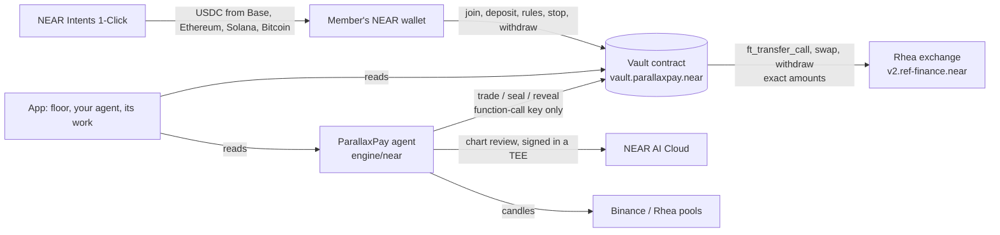

# ParallaxPay

[](https://github.com/shariqazeem/presage/actions/workflows/ci.yml)

An AI agent that trades for you on NEAR, inside rules you set.

You fund your own account in the ParallaxPay vault (a NEAR contract) and choose how the agent runs: ask first or autopilot, how picky it is, which coins, the largest buy and how many buys a day. The vault enforces those rules on every agent trade, swaps only through Rhea pools the owner has listed, and pays withdrawals to the member and nobody else. Before each trade the agent seals its plan on NEAR (a sha256 fingerprint); after the trade it opens the plan, and anyone can check it against the seal.

## Built for the NEAR HACKATHON (1–14 Nov 2026)

| Piece | Where | NEAR tech used |
| --- | --- | --- |
| Vault contract | [`near/vault`](near/vault) (Rust, near-sdk 5.27, 43 unit tests) | NEAR smart contract, Rhea (Ref) exchange `v2.ref-finance.near`, NEP-141 tokens, NEP-297 events |
| Agent | [`engine/near`](engine/near) | Function-call access key limited to the vault, NEAR RPC, NEAR AI Cloud (analyst in a TEE, signed answers) |
| App | [`app/page.tsx`](app/page.tsx) (the floor), [`app/desk`](app/desk) (your agent), [`app/start`](app/start) (hiring it), [`app/record`](app/record) (its work), [`app/how-it-trades`](app/how-it-trades), [`app/fund`](app/fund), [`components/near`](components/near) | NEAR Connect (HOT, Meteor, Intear, MyNearWallet, …), NEAR Intents 1-Click |
| The agent's drawings | [`components/near/AgentDrawing.tsx`](components/near/AgentDrawing.tsx), [`lib/near/drawing.ts`](lib/near/drawing.ts) | The agent's own support/resistance, trendline and money-flow code, run in the browser on the same candles it reads |
| Shared code | [`lib/near`](lib/near) | Read-only RPC client, Rhea quotes, vault types, 1-Click helpers |
| Mainnet setup | [`scripts/near/setup.ts`](scripts/near/setup.ts) | Account creation, deploy, storage registration, routes |

**Disclosure.** ParallaxPay existed before this hackathon as a product on Metis (calls sealed on Metis, a paid oracle, an agent builder). That state is tagged `pre-hackathon`; everything after the tag is the NEAR build, and `git diff pre-hackathon..hackathon-submission` shows all of it. The chart-reading rules the agent applies ([`engine/stquant`](engine/stquant), the founder's own method, formerly run as "ST Quant") predate the hackathon; their NEAR-specific risk rules are new.

### How it fits together



The vault holds each member's coins and rules. The agent can only call `trade`, `seal`, `reveal` and `recover`, and the vault checks every trade against the member's rules before it touches Rhea. Withdrawals go to the member only.

### Try it

1. Open the app (hosted at https://parallaxpay.80.225.209.190.sslip.io) and watch the agent read the coin closest to a trade. Its drawing plays in front of you: candles, the support and resistance it mapped (with touch counts), its trendlines and money flow, all computed with its own code. It says in one sentence what it is waiting for, its six checks tick in, and **The exact chart it read** opens the four-timeframe image it actually analysed. It re-reads NEAR, ZEC, RHEA and AURORA every 15 minutes.
2. Press **Hire ParallaxPay**. It introduces itself on its live chart, then asks four questions (ask first or autopilot, how picky, which coins, how big) while your mandate fills in. Connect a NEAR wallet and **Sign on NEAR** (0.02 NEAR for storage, returned if you leave), then see your mandate on NEAR:
   ```bash
   near contract call-function as-read-only vault.parallaxpay.near get_member json-args '{"account_id":"YOU.near"}' network-config mainnet now
   ```
3. Add USDC from your wallet into the vault, or open **/fund** to bring USDC from Base, Ethereum, Solana, Arbitrum, Tron or Bitcoin through NEAR Intents, and see the balance on **Your agent**.
4. With **Ask first**, wait for a proposal: the agent's message with the sealed plan drawn on its chart. Press **Approve**, then see the trade on nearblocks: one transaction that deposits into the vault's Rhea account, swaps, and withdraws back, with the exact amounts in its `trade_end` event.
5. Ask it anything ("Why aren't you buying NEAR?") on the floor or on **Your agent**, and see it answer from its live checklist, on NEAR AI Cloud.
6. Open **Its work** and any promise in it: the plan drawn on the chart it was sealed on with where it got in and out, the promise step by step (sealed, bought, sold, opened), then your browser recompute `sha256(salt ‖ plan)` against the fingerprint the vault holds and check the NEAR AI Cloud enclave's signature on the analyst's verdict.
7. Turn **Autopilot** off and see it off on NEAR at once; press **Withdraw** and see the coins arrive in your wallet.

### Run it locally

```bash
npm install
npm run dev            # the app at http://localhost:3000
npm run engine:near    # the agent: reads markets without keys, trades once NEAR_AGENT_KEY is set
npm run near:test      # the vault's 43 unit tests
npm run near:build     # near/vault/target/near/parallaxpay_vault.wasm
npm run near:e2e       # the vault's whole life on NEAR testnet against Rhea's real exchange (27 checks)
```

`near:e2e` makes throwaway accounts from the testnet faucet, opens a USDC/wNEAR pool on `ref-finance-101.testnet`, deploys the vault and runs join, deposit, an agent buy with its plan sealed, a sell, the plan opened, a buy that misses its minimum, the limits the vault must refuse, withdraw and leave, checking every balance against the vault's state. The last run passed all 27 checks: [vault.pp-e2e-mw2mf9t4.testnet](https://testnet.nearblocks.io/address/vault.pp-e2e-mw2mf9t4.testnet).

Environment for the agent (in `.env.local`): `NEAR_AGENT_KEY` (the function-call key from `scripts/near/setup.ts agent`), `NEAR_AI_API_KEY` (NEAR AI Cloud), optionally `NEAR_AI_MODEL` (default `z-ai/glm-5.3-flash`) and `ONECLICK_JWT`.

### Mainnet accounts

| Account | Role |
| --- | --- |
| `vault.parallaxpay.near` | The vault contract |
| `agent.parallaxpay.near` | The agent. Its server key can only call `trade`, `seal`, `reveal` and `recover` on the vault, with no deposit |
| `parallaxpay.near` | The owner: lists coins and pools, sets the agent account, pauses trading. It can't move members' coins |

### How one trade works

1. The agent reads candles for each coin on four timeframes (Binance for NEAR and ZEC, the coin's own Rhea pool for RHEA and AURORA) and applies its rules: buy only at support a higher timeframe confirms, with money flow (MFI) bottomed and the daily trend not falling; stop just under the level; sell at the next resistance worth at least 2.5 times the risk, or after 72 hours.
2. When the rules find a setup, an open model on NEAR AI Cloud reviews the chart against the same rubric. It can pass or lower the grade, never raise it, and the enclave signs its answer.
3. For each member whose rules fit, the agent sizes the trade (style and grade decide the share of the member's largest buy), quotes it on Rhea, and calls `vault.trade` with the plan's fingerprint. The vault checks the member's rules, then runs three steps, each confirmed by a callback with exact amounts: `ft_transfer_call` into its own Rhea account, `swap` (Rhea returns the amount out), `withdraw` back (Rhea reports what arrived). One trade runs at a time, so `recover` can always settle a trade that stopped part-way from what Rhea holds.
4. Ask-first members get a proposal sealed with `vault.seal`; they approve it from their own wallet, and the server records it only after reading the transaction back from NEAR.
5. On exit the agent sells back to USDC and calls `vault.reveal`, which checks the plan against its seal and logs it.

### Known limits

- One trade at a time across the vault; the agent queues members.
- Coins are limited to what Rhea can swap deeply against native USDC, all through the USDC/wNEAR pool 4512: NEAR, ZEC (pool 6065), RHEA (6458) and AURORA (5469). BTC, ETH and SOL can be brought in through NEAR Intents but aren't traded by the vault.
- The owner can upgrade this hackathon deployment with the vault account's full-access key. That key is to be removed or put behind a timelock before real money uses it.
- Not financial advice. The agent can lose money; its record shows losses as they happen.

---

## Before the hackathon

ParallaxPay started as an x402 pay-per-call agent (2nd place, Gradient's Parallax Eco Track in the Solana x402 hackathon) and then ran on Metis as a public record of AI trading calls. That version is at the `pre-hackathon` tag. The NEAR build replaced its app: the Metis pages are gone from the site and redirect here.
